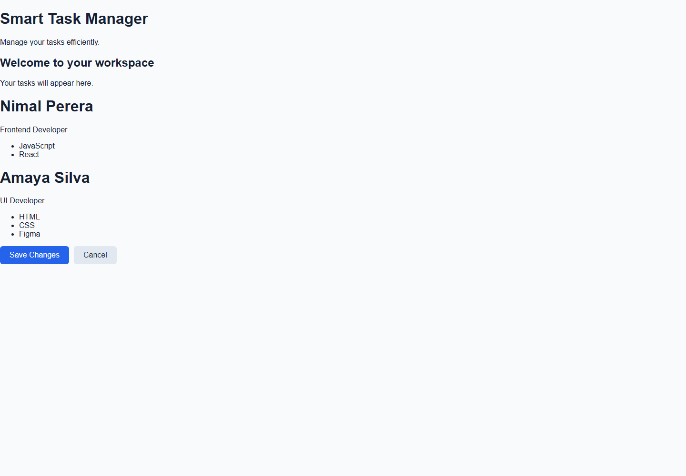

# Smart Task Manager

## Project overview and purpose

Smart Task Manager is a React learning project for building a task management interface from reusable components. Day 01 focuses on JSX, functional components, props, list rendering, conditional rendering, and click handlers.

The current page displays a welcome message, two developer profiles, and reusable action buttons. Task list and task card components are also implemented with sample data, but are not yet rendered by `App`.

## Technologies used

| Technology | Purpose |
| --- | --- |
| React 19 and React DOM | Component-based interface and browser rendering |
| JavaScript (ES modules) and JSX | Application logic and component markup |
| Vite 8 with the React plugin | Local development server and production builds |
| CSS and inline styles | Base styles, button variants, and task completion styling |
| ESLint with React Hooks and React Refresh plugins | Static code checks |
| npm | Dependency management and project scripts |

## Installation and local development

### Prerequisites

- Node.js 20.19+ on the Node 20 release line, or Node.js 22.12+ on a newer release line, as required by the installed Vite version. This project was checked using Node.js 24.21.0.
- npm, included with Node.js.

### Setup

Open a terminal in the project directory and install the locked dependencies:

```sh
cd react-task-manager
npm ci
```

Start the development server:

```sh
npm run dev
```

Open the local URL printed by Vite, usually `http://localhost:5173`. Changes to source files appear automatically during development. Stop the server with `Ctrl+C`.

On Windows PowerShell, if script execution policy blocks `npm.ps1`, use `npm.cmd` instead of `npm` in these commands.

### Other commands

| Command | Purpose |
| --- | --- |
| `npm run lint` | Run ESLint checks |
| `npm run build` | Generate a production build in `dist/` |
| `npm run preview` | Serve the production build locally after running the build command |

The current app does not require environment variables, a backend, or a database.

## Component hierarchy

The currently rendered component tree is:

```text
main.jsx (StrictMode)
`-- App
    |-- Header
    |-- Welcome section (HTML)
    |-- ProfileCard (Nimal Perera)
    |-- ProfileCard (Amaya Silva)
    |-- Button (Save Changes, primary)
    `-- Button (Cancel, secondary)
```

The task components exist separately and are ready to be connected to `App`:

```text
TaskList
|-- reads sampleTasks from src/data/sampleTasks.js
`-- TaskCard (one per task, keyed by task.id)
```

### Data flow and props

| Component | Inputs and responsibility |
| --- | --- |
| `App` | Supplies profile props and button click handlers; does not currently hold task state |
| `Header` | Displays the fixed application title and description; accepts no props |
| `ProfileCard` | Receives `name`, `role`, and `skills`; maps skills into a list |
| `Button` | Receives `label`, `variant`, and `onClick`; defaults to the primary variant |
| `TaskList` | Imports `sampleTasks` directly; displays an empty message or maps tasks into cards |
| `TaskCard` | Receives a `task` object and displays its `title`, `priority`, and `completed` status |

Data passes from parents to children through props. `TaskList` currently reads its own static data rather than receiving a `tasks` prop. Neither `ProfileCard` nor `TaskCard` currently renders a `Button`.

## Completed Day 01 features

- Set up a React application with Vite, a lockfile, and ESLint configuration.
- Added an application header and workspace welcome section.
- Created a reusable `ProfileCard` and rendered two profiles with roles and skill lists.
- Created a reusable `Button` with primary and secondary visual variants.
- Connected Save Changes and Cancel buttons to demonstration alerts.
- Added five sample tasks with IDs, titles, priorities, and completion flags.
- Implemented `TaskList` with stable task keys and an empty-list message.
- Implemented `TaskCard` with priority and completion labels, plus faded cards and struck-through titles for completed tasks.
- Added global base CSS and inline styles for buttons and task cards.

The task list and task card features are implemented in source; the current page still shows the task placeholder.

## Screenshots

### Day 01 workspace

Actual browser capture of the current application at a 1440 x 1000 viewport. It shows the header, welcome message, developer profiles, and action buttons. Task cards are not visible because `TaskList` is not mounted in `App` yet.



## Known limitations

- `App` does not import or render `TaskList`, so sample tasks are not visible on the main page.
- Tasks are static; users cannot create, edit, delete, or toggle completion.
- Save Changes and Cancel display alerts only; there is no editable form or saved state.
- There is no persistence, backend integration, or authentication.
- `src/App.css` defines layout styles but is not imported, so those styles are not applied. Responsive layout refinement is still pending.
- No automated test suite is configured.

## Day 02 objectives

- Render `TaskList` inside `App` so tasks appear in the workspace.
- Move tasks into React state in `App` and pass tasks and action callbacks through props.
- Add task creation with validation for empty titles.
- Support completion toggling and task deletion.
- Add filters for task status and priority.
- Persist tasks in `localStorage` across page reloads.
- Connect the layout stylesheet and improve spacing, mobile layout, and keyboard accessibility.
- Verify task interactions and update screenshots to reflect the completed interface.
